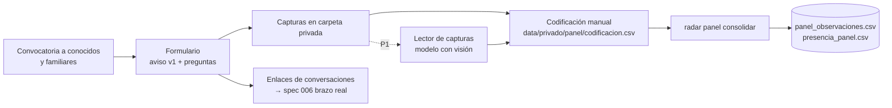

# Plan 005 · Panel ciudadano y TikTok

## Flujo

## Herramientas

- **Formulario:** cualquier servicio que permita subir archivos y casillas obligatorias, por ejemplo Google Forms con carga a una carpeta privada. Campos:
  - aceptación del aviso (obligatoria);
  - rango de edad;
  - estado o país;
  - las preguntas 3 a 5;
  - capturas por consulta (C1–C4);
  - captura de comentarios (opcional);
  - enlace o texto de la conversación con el asistente (opcional);
  - casilla de autorización para publicar el texto del asistente.
- **Identificador:** cada envío recibe un código `Pnn` en orden de llegada. La relación entre envío y código queda en `data/privado/panel/participantes.csv`.

## Módulos

| Archivo | Responsabilidad |
|---|---|
| `radar/panel/consolidar.py` | Valida la codificación (columnas, valores permitidos, posiciones del 1 al 12, `destino_id` del catálogo), elimina columnas prohibidas, calcula la presencia con el intervalo de Wilson y escribe las tablas |
| `radar/panel/lector.py` | (P1) Envía cada captura al modelo con visión, con salida estructurada `{posicion, texto_visible, vistas, destino_id}` |
| `radar/comun/estadistica.py` | Intervalo de Wilson (lo comparten 005, 006 y 008) |

## Cálculo de la presencia

Para cada destino *d*:
- `n_sesiones` = sesiones completas (las cuatro consultas);
- `k_sesiones` = sesiones en que *d* aparece en alguna de las cuatro consultas, en posiciones 1 a 12;
- `presencia_pct = k / n × 100`, con el intervalo de Wilson al 95 %.

También se calcula `presencia_por_consulta` (misma fórmula por consulta), útil para la ficha.

## Pruebas

- Validación de la codificación con un CSV de ejemplo que contiene errores.
- Prueba de que la salida no tiene columnas prohibidas.
- Intervalo de Wilson contra valores conocidos: con k=0 y n=10 el límite superior es ≈ 27.8 %.

## Riesgos

| Riesgo | Mitigación |
|---|---|
| Pocas respuestas a tiempo | Convocar en cuanto el formulario esté listo; meta mínima de 15; los resultados se presentan con intervalo |
| Capturas incompletas | El protocolo pide 12 resultados; las sesiones incompletas se excluyen de `n_sesiones` |
| Sesgo por ser conocidos del equipo | Se declara: panel de conveniencia, mayoría de Puebla; se reporta la región de residencia |
