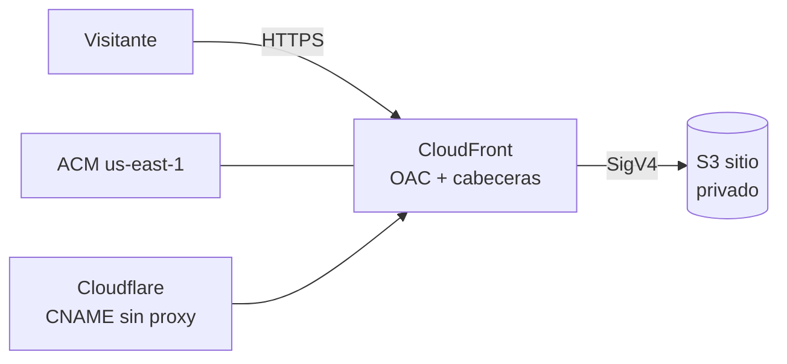

# Plan 010 · Infraestructura

## Recursos (P0)

| Archivo | Contenido |
|---|---|
| `infra/versions.tf` | Versiones de Terraform y proveedores |
| `infra/providers.tf` | Proveedor AWS con perfil y región; alias `us_east_1` para ACM |
| `infra/variables.tf` | `perfil_aws`, `region`, `dominio`, `entorno`, `proyecto` |
| `infra/sitio.tf` | Bucket, OAC, CloudFront, política del bucket y política de cabeceras |
| `infra/certificado.tf` | ACM y su validación |
| `infra/cognito.tf` | Grupo de usuarios, dominio con Hosted UI y cliente público con PKCE (ADR-0009) |
| `infra/outputs.tf` | Bucket, id y dominio de CloudFront, registros DNS por crear |
| `infra/desplegar.sh` | Sincronización e invalidación |
| `infra/README.md` | Pasos de aplicación con el paso manual de Cloudflare |

## Pasos de aplicación (primera vez)

1. `cd infra && terraform init`.
2. `terraform apply -target=aws_acm_certificate.sitio` crea el certificado y muestra el CNAME de validación.
3. Crear en Cloudflare el CNAME de validación (sin proxy).
4. `terraform apply` espera la validación, crea CloudFront y muestra `cloudfront_dominio`.
5. Crear en Cloudflare el CNAME `techcapital` → `cloudfront_dominio` (sin proxy, «DNS only»).
6. `make web-config && make web && make desplegar`. `make web-config` deja en `web/.env` el dominio y el cliente de Cognito; sin eso la compilación queda en modo local y `desplegar.sh` la rechaza.
7. Dar de alta las cuentas con `aws cognito-idp admin-create-user` (comando en `infra/README.md`).

## Costos esperados

Con el tráfico de una demostración y un piloto (decenas de miles de solicitudes al mes, menos de 1 GB transferido), S3 y CloudFront quedan en centavos de dólar al mes y el certificado ACM no tiene costo. La cifra exacta se calcula en T010-06 con la calculadora oficial.

## Recolección programada (P2, diseño)

- Bucket `…-datos` con prefijos `crudo/` y `curado/`, versionado y ciclo de vida de 90 días para `crudo/`.
- Lambda Python 3.12 empaquetada con `uv export` y una capa con las dependencias; ejecuta `radar senales youtube` y `radar asistentes correr` con un tope de corridas.
- EventBridge Scheduler: el día 5 de cada mes a las 09:00 de Ciudad de México.
- Llaves en SSM Parameter Store (`SecureString`), leídas al iniciar.
- Google Trends queda fuera de la Lambda (ADR-0008).
