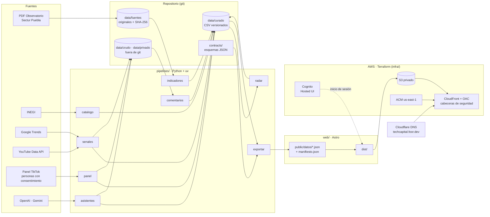

# Arquitectura

## Vista general

## Componentes

| Componente | Tecnología | Responsabilidad | Spec |
|---|---|---|---|
| Pipelines | Python ≥ 3.11 con uv, pandas, pdfplumber, Typer | Ingesta, limpieza, análisis y exportación. Un módulo por contexto del dominio | 001–008 |
| Datos curados | CSV en git | Lenguaje publicado entre contextos; base de la reproducibilidad | todas |
| Contratos | JSON Schema 2020-12 | Forma de los archivos que consume el sitio | 009 |
| Página pública | Astro, Tailwind CSS 4, d3 7, anime.js 4 | Problema, qué hace la plataforma, uso en el Tianguis, método y descargas (`/`) | 009 |
| Plataforma | Astro, d3 7, anime.js 4 | Vistas Radar, Fichas, Asistentes y Redes, con selección compartida (`/plataforma/`). Estática y sin llaves | 009 |
| Acceso | Amazon Cognito con Hosted UI, código de autorización con PKCE | Cuentas dadas de alta por el equipo; inicio y cierre de sesión de la plataforma ([ADR-0009](decisiones/0009-landing-publica-y-plataforma-con-cognito.md)) | 009, 010 |
| Hospedaje | S3 privado, CloudFront con OAC, ACM, política de cabeceras | Servir el sitio con HTTPS en un subdominio de foor.dev | 010 |
| DNS | Cloudflare (zona foor.dev) | Registro CNAME sin proxy hacia CloudFront y validación del certificado | 010 |
| Recolección programada (P2) | Lambda + EventBridge Scheduler, bucket de datos | Repetir mensualmente YouTube y la auditoría de asistentes | 010 |
| Carga del panel (P2) | Lambda con URL firmada de S3 | Recibir capturas del panel sin exponer el bucket | 005, 010 |

## Flujo de una actualización

1. `make datos` ejecuta, en orden: `catalogo` → `indicadores` → `senales` → `panel` → `asistentes` → `comentarios` → `radar`. Cada etapa lee solo lo publicado por las anteriores.
2. `make exportar` genera `web/public/datos/*.json`, valida cada archivo contra `contracts/` y escribe `manifiesto.json` con la SHA-256 de cada uno.
3. `make web` compila el sitio. El navegador verifica la SHA-256 de cada JSON contra el manifiesto antes de dibujarlo.
4. `make desplegar` sincroniza `web/dist/` con S3 e invalida la caché de CloudFront.

## Dónde corre cada etapa

| Etapa | Dónde | Motivo |
|---|---|---|
| Indicadores, radar y exportación | Cualquier computadora con el repositorio | No usa llaves |
| Google Trends | Computadora de un integrante, con conexión residencial | Trends responde 429 a direcciones de nube ([ADR-0008](decisiones/0008-trends-desde-red-residencial.md)) |
| YouTube y asistentes | Computadora con `.env`; en P2, Lambda programada | Requiere llaves |
| Panel | Teléfonos de los participantes, con captura manual | Constitución IV ([ADR-0004](decisiones/0004-panel-con-consentimiento.md)) |
| Terraform y despliegue | Computadora con el perfil AWS `Fortino-IAM-Admin` | Un solo operador de infraestructura durante el hackathon |

## Seguridad

- Las llaves solo están en `.env`, que está en `.gitignore`. `make verificar` busca patrones de llaves en los archivos versionados.
- Los buckets bloquean el acceso público. CloudFront accede con OAC.
- La política de cabeceras de CloudFront incluye HSTS, `X-Content-Type-Options`, `X-Frame-Options: SAMEORIGIN`, `Referrer-Policy` y una política de contenido acotada a `self`.
- El sitio no hace llamadas a APIs externas, salvo el intercambio de código por token con el dominio de Cognito.
- La plataforma pide sesión de Cognito. Es una protección de experiencia: los datos publicados son públicos por diseño (ADR-0009).
- `data/privado/` y `data/crudo/` nunca se suben a git ni al sitio. Lo crudo se conserva en la computadora que lo generó y su SHA-256 queda en las tablas curadas.

## Calidad

| Verificación | Comando | Cuándo |
|---|---|---|
| Pruebas unitarias e integración de pipelines | `uv run pytest` | Cada commit con código |
| Estilo | `uv run ruff check . && uv run ruff format --check .` | Cada commit con código |
| Huellas de fuentes | `uv run radar fuentes` | Antes de `make datos` |
| Contratos | `uv run pytest tests/test_contratos.py` y `uv run radar exportar --validar` | Antes de compilar el sitio |
| Compilación del sitio | `npm run build` en `web/` | Antes de desplegar |
| Revisión visual | Capturas a 1440×900, 1280×720 y 390×844 | Antes de desplegar |
| Infraestructura | `terraform fmt -check && terraform validate` | Antes de `apply` |

## Decisiones registradas

| ADR | Decisión |
|---|---|
| [0001](decisiones/0001-sdd-y-ddd.md) | Desarrollo guiado por especificaciones con modelo de dominio explícito |
| [0002](decisiones/0002-sitio-estatico-con-manifiesto.md) | Sitio estático con datos JSON y manifiesto SHA-256 |
| [0003](decisiones/0003-eventos-como-archivos.md) | Eventos de dominio como archivos fechados |
| [0004](decisiones/0004-panel-con-consentimiento.md) | Panel con consentimiento en lugar de extracción automatizada |
| [0005](decisiones/0005-visibilidad-como-porcentaje.md) | Visibilidad en asistentes como porcentaje sobre corridas repetidas, con dos brazos |
| [0006](decisiones/0006-aws-terraform-cloudflare.md) | AWS con Terraform y DNS en Cloudflare |
| [0007](decisiones/0007-python-uv-csv.md) | Python con uv y CSV versionados |
| [0008](decisiones/0008-trends-desde-red-residencial.md) | Google Trends desde una red residencial |
| [0009](decisiones/0009-landing-publica-y-plataforma-con-cognito.md) | Página pública y plataforma con acceso por Cognito |
