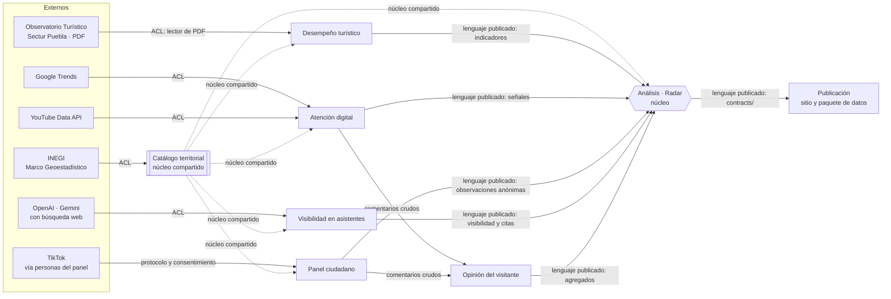

# Mapa de contextos

## Subdominios

| Subdominio | Tipo | Por qué |
|---|---|---|
| Análisis (radar) | **Núcleo** | Cruzar la atención con el desempeño y priorizar destinos es lo que nadie más ofrece |
| Visibilidad en asistentes | **Núcleo** | Medir qué recomiendan los asistentes por destino e idioma es el diferenciador principal |
| Panel ciudadano | **Núcleo** | Es la única vía legítima de saber qué muestra TikTok a personas reales |
| Atención digital (búsqueda, YouTube) | Soporte | Señales públicas que alimentan al núcleo |
| Opinión del visitante | Soporte | Clasifica comentarios y protege datos personales |
| Desempeño turístico | Soporte | Traduce la estadística oficial al lenguaje del radar |
| Catálogo territorial | Genérico (núcleo compartido) | Identidad de los destinos; todos dependen de él |
| Publicación | Genérico | Sitio estático y paquete de datos |

## Relaciones

## Tipos de relación

| Relación | Patrón | Regla práctica |
|---|---|---|
| Externos → contextos | **Capa anticorrupción (ACL)** | Cada fuente externa se traduce al lenguaje ubicuo en un solo módulo. Los nombres del PDF («Cd.Puebla», «rCousartos disponibles») no salen del lector. Las respuestas de API no salen de su cliente |
| Catálogo → todos | **Núcleo compartido** | `destino_id` es la llave común. Solo el contexto Catálogo lo crea o lo cambia, y cualquier cambio se acuerda con todos |
| Contextos de soporte → Radar | **Cliente-proveedor con lenguaje publicado** | Cada proveedor publica tablas en `data/curado/` con columnas documentadas en `modelo-de-datos.md`. El Radar no lee datos crudos ni importa código interno de otro contexto |
| Atención y Panel → Opinión | **Cliente-proveedor con frontera de privacidad** | Los comentarios crudos se guardan en `data/privado/` y solo los lee Opinión. Hacia fuera solo salen agregados |
| Radar → Publicación | **Conformista** | El sitio se adapta a los esquemas de `contracts/`. Si el sitio necesita otro dato, se cambia primero el contrato y luego el exportador |

## Reglas que se verifican en código

1. Ningún módulo de `pipelines/src/radar/<contexto>/` importa código de otro contexto, salvo los compartidos: `catalogo`, `comun`, `config`, `fuentes` y `texto`. Una prueba de arquitectura lo comprueba (spec 008, T008-01).
2. El Radar solo lee archivos de `data/curado/`.
3. El exportador valida cada JSON contra su esquema de `contracts/` antes de escribirlo.
4. Ningún archivo publicado contiene columnas de identidad personal: `usuario`, `autor`, `nombre_participante`, `texto_comentario`.
