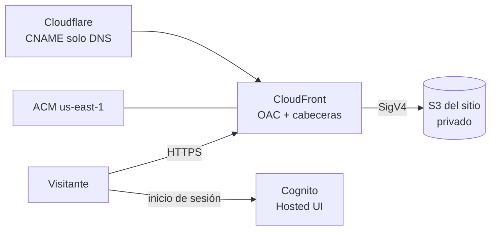

# Infraestructura

Hospedaje del sitio en AWS (spec 010, ADR-0006): bucket S3 privado, CloudFront con OAC y cabeceras de seguridad, certificado ACM en `us-east-1` y acceso a la plataforma con Cognito y su Hosted UI (ADR-0009). La zona `foor.dev` está en Cloudflare, así que los dos registros DNS se crean a mano a partir de las salidas de Terraform.



| Archivo | Contenido |
|---|---|
| `versions.tf` | Versiones de Terraform y del proveedor AWS |
| `providers.tf` | Proveedor con perfil y región, alias `us_east_1` para ACM y etiquetas |
| `variables.tf` | `perfil_aws`, `region`, `dominio`, `entorno`, `proyecto` y `cognito_prefijo` |
| `sitio.tf` | Bucket, política, OAC, función de índice, cabeceras y distribución |
| `certificado.tf` | Certificado y su validación |
| `cognito.tf` | Grupo de usuarios, dominio de la Hosted UI y cliente público con PKCE |
| `outputs.tf` | Bucket, distribución, registros DNS por crear y datos públicos de Cognito |
| `funciones/indice.js` | Agrega `index.html` a las rutas de carpeta |
| `desplegar.sh` | Sincroniza `web/dist/` e invalida la caché |

## Requisitos

- Terraform ≥ 1.9 y AWS CLI v2.
- Perfil `Fortino-IAM-Admin` configurado. Se comprueba con `aws sts get-caller-identity --profile Fortino-IAM-Admin`.
- Acceso a la zona `foor.dev` en Cloudflare.

## Primera aplicación

1. Inicializar: `cd infra && terraform init`.
2. Crear solo el certificado:
   ```bash
   terraform apply -target=aws_acm_certificate.sitio
   terraform output dns_validacion_certificado
   ```
3. En Cloudflare, crear el registro CNAME de validación con el nombre y el valor de la salida, con **proxy desactivado (solo DNS)**.
4. Aplicar todo: `make infra-aplicar` desde la raíz. Terraform espera a que el certificado quede emitido (hasta 45 minutos; suele tardar menos de 5) y luego crea la distribución.
5. En Cloudflare, crear el CNAME del subdominio con los datos de `terraform output dns_sitio`, también **solo DNS**.
6. Escribir la configuración pública de Cognito en `web/.env`, compilar y desplegar desde la raíz: `make web-config && make web && make desplegar`.
7. Dar de alta las cuentas (ver abajo).

Si el prefijo `radar-turistico-puebla` ya está tomado en la región, se cambia con `-var="cognito_prefijo=otro-prefijo"`.

## Cuentas de la plataforma

No hay registro abierto. Cada cuenta se crea así y la persona recibe por correo una contraseña temporal que cambia al entrar:

```bash
aws cognito-idp admin-create-user --profile Fortino-IAM-Admin \
  --user-pool-id "$(terraform output -raw cognito_grupo_usuarios_id)" \
  --username persona@correo.com \
  --user-attributes Name=email,Value=persona@correo.com Name=email_verified,Value=true
```

Para borrar una cuenta: `aws cognito-idp admin-delete-user --user-pool-id … --username persona@correo.com --profile Fortino-IAM-Admin`.

Para otro subdominio: `terraform apply -var="dominio=otro.foor.dev"`.

## Despliegues siguientes

```bash
make exportar   # si cambiaron los datos
make web        # web/.env ya tiene la configuración de Cognito
make desplegar
```

`desplegar.sh` se niega a publicar una compilación en modo local (sin Cognito). Sube primero los recursos con huella (`_astro/`, caché de un año), después el HTML, los datos y las descargas (`no-cache`) y al final invalida `/*`.

## Comprobaciones de seguridad (T010-05)

```bash
# Cabeceras de seguridad presentes
curl -sI https://techcapital.foor.dev | grep -iE "strict-transport|content-security|x-frame|x-content-type|referrer"

# Acceso directo al bucket rechazado (403)
curl -sI "https://$(terraform output -raw bucket_sitio).s3.amazonaws.com/index.html" | head -1
```

## Estado y limpieza

- El estado de Terraform es local (`terraform.tfstate`) y no se versiona. Solo una persona aplica durante el hackathon. Si el piloto continúa, se pasa a un backend S3 con `use_lockfile = true`.
- Para borrar todo: vaciar el bucket (`aws s3 rm s3://<bucket> --recursive --profile Fortino-IAM-Admin`) y luego `terraform destroy`. Después se borran los dos registros en Cloudflare.

## Costos

Con el tráfico de una demostración y de un piloto, S3 y CloudFront cuestan centavos de dólar al mes y el certificado no tiene costo. La estimación con fuente queda en `docs/entregables/modelo-de-operacion.md` (T010-06).
