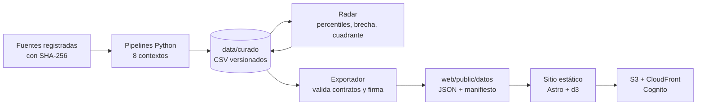

# 7. Arquitectura y metodología

La arquitectura completa, con componentes, seguridad y calidad, está en [`../arquitectura.md`](../arquitectura.md). Aquí va el resumen de cómo fluyen los datos y por qué.

## Decisiones que definen la arquitectura

| Decisión | Efecto | Registro |
|---|---|---|
| Un contexto por tema y comunicación solo por archivos curados | Cada etapa se prueba y se vuelve a correr sola; una prueba revisa que ningún contexto importe a otro | [`../decisiones/`](../decisiones/) (ADR-0003) |
| Contratos JSON entre análisis y sitio | El sitio no calcula nada: dibuja lo que el exportador validó | [`../../contracts/`](../../contracts/) |
| Manifiesto con SHA-256 verificado en el navegador | Una cifra alterada se detecta y se avisa | `web/src/scripts/datos.js` |
| Panel con consentimiento y no extracción automatizada | TikTok se mide sin violar términos de la plataforma | ADR-0004 |
| Google Trends desde red residencial | La nube recibe límites de la plataforma | ADR-0008 |
| Sitio estático con inicio de sesión de Cognito | Sin servidor que mantener; cuentas dadas de alta por el equipo | ADR-0009 |

## Metodología de análisis

1. **Periodo de referencia:** los últimos 12 meses publicados por el Observatorio.
2. **Percentil por componente:** cada Pueblo Mágico se ubica entre los 12 en cada componente de atención (búsqueda, video, panel, asistentes) y en ocupación. Los empates promedian su posición.
3. **Índice de atención:** promedio de los percentiles de los componentes disponibles; se necesitan al menos dos.
4. **Índice de desempeño:** percentil de la ocupación hotelera de los últimos 12 meses. Las llegadas, los cuartos libres y la derrama se muestran en la ficha como contexto.
5. **Brecha y cuadrante:** brecha = atención − desempeño; los cuadrantes se cortan en la mediana de cada eje.
6. **Sensibilidad:** con tres o más componentes se repite el cálculo quitando uno y se marca el destino si cambia de cuadrante.
7. **Incertidumbre:** la visibilidad en asistentes lleva intervalo de Wilson al 95 %.

Las fórmulas están en el sitio («Cómo se hizo») y en [`../../specs/008-radar/spec.md`](../../specs/008-radar/spec.md).
