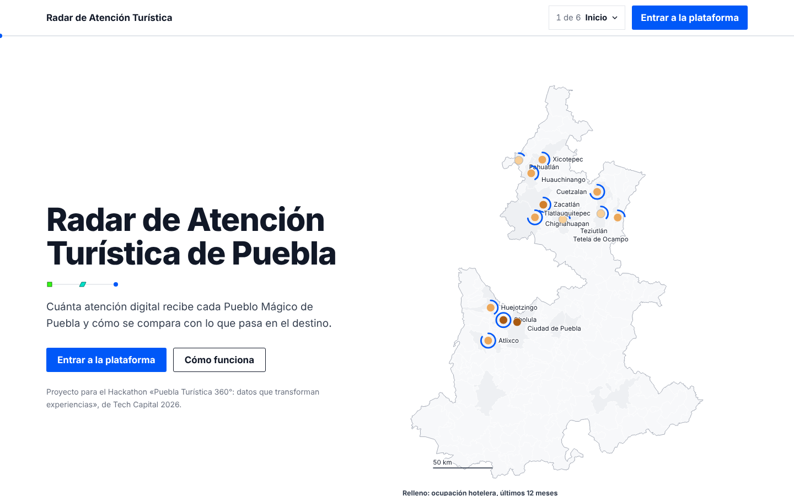
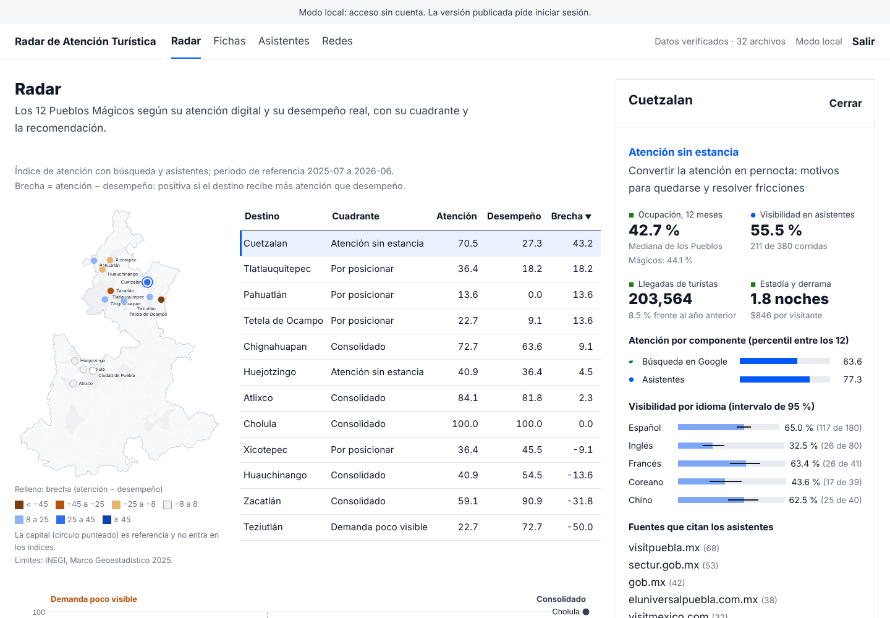
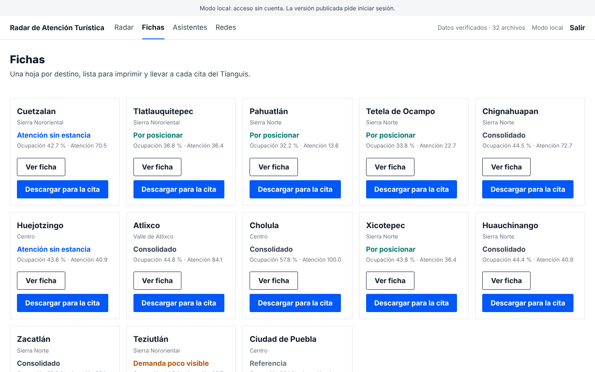
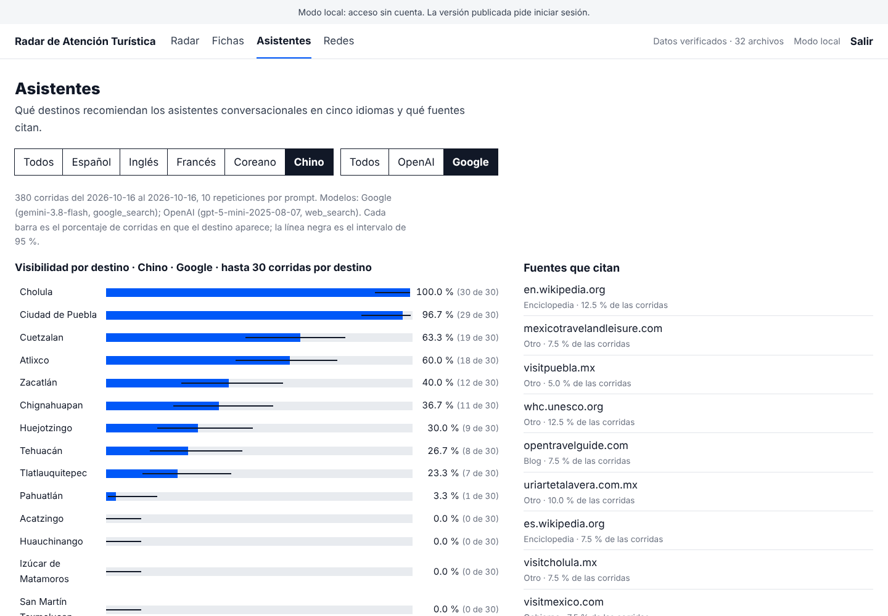

# 8. Prototipo funcional

El prototipo es el sitio de `web/`: una página pública y una plataforma con inicio de sesión. Se compila a archivos estáticos y funciona sin llamadas a servicios externos, salvo el inicio de sesión de Cognito en la versión desplegada.

## Cómo verlo

| Modo | Comando | Qué ves |
|---|---|---|
| Local, sin cuenta | `make dev` | Página pública en `/` y plataforma en `/plataforma/` con la banda «Modo local» |
| Compilado | `make web` y servir `web/dist/` | Lo mismo, sin conexión (comprobado con `make revisar`) |
| Desplegado | `make desplegar` | HTTPS en el subdominio acordado y plataforma con inicio de sesión (pendiente de la infraestructura, spec 010) |

## Qué hace cada pantalla

**Página pública (`/`)**

Mapa de los 12 Pueblos Mágicos y la capital: el relleno es la ocupación y el anillo, la atención. Siguen el problema, la plataforma, el Tianguis 2027, el método y las descargas.

**Radar**

Mapa por brecha, tabla ordenable, cuadrantes y panel de ficha. Elegir un destino en cualquier lugar lo marca en los demás y abre `#radar/<destino>`.

**Fichas**

Doce tarjetas con «Descargar para la cita», que imprime una hoja carta con las cifras del destino.

**Asistentes**

Visibilidad por destino con intervalo de 95 %, alternas de idioma y proveedor, fuentes citadas y un ejemplo.

## Verificación de datos

El pie de la página y la barra de la plataforma muestran «Datos verificados: n de n archivos…». Si se altera un byte de un archivo, el aviso cambia y se desaconseja usar las cifras.

## Calidad

- `make verificar`: pruebas, estilo, huellas, catálogo y contratos.
- `make revisar`: desborde horizontal, texto de gráficas, negritas, errores de consola, verificación de datos y ausencia de recursos externos a 1440, 1280 y 390 px.
