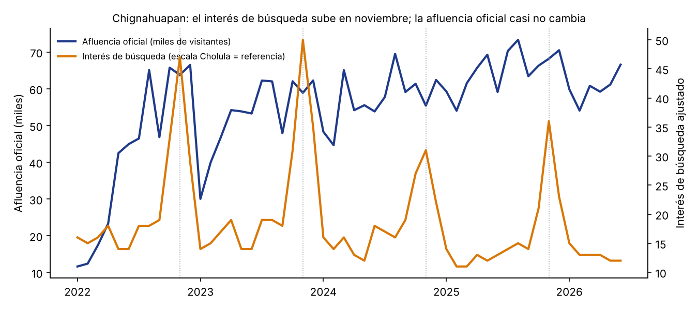

# Resultados

Notas de resultados que alimentan los documentos de entrega. Cada cifra sale de `data/curado/`; si cambia la tabla, se regenera la nota.

## Tablas generadas

<!-- generado:inicio -->
Periodo de referencia: 2025-07 a 2026-06.

**Radar por destino** (ordenado por brecha)

| Destino | Cuadrante | Atención | Desempeño | Brecha | Ocupación 12 m (%) |
|---|---|---|---|---|---|
| Cuetzalan | Atención sin estancia | 68.2 | 27.3 | 40.9 | 42.7 |
| Tlatlauquitepec | Por posicionar | 31.8 | 18.2 | 13.6 | 36.8 |
| Pahuatlán | Por posicionar | 13.6 | 0.0 | 13.6 | 32.2 |
| Tetela de Ocampo | Por posicionar | 22.7 | 9.1 | 13.6 | 33.8 |
| Chignahuapan | Consolidado | 72.7 | 63.6 | 9.1 | 44.5 |
| Huejotzingo | Atención sin estancia | 45.5 | 36.4 | 9.1 | 43.6 |
| Atlixco | Consolidado | 86.4 | 81.8 | 4.5 | 44.8 |
| Cholula | Consolidado | 100.0 | 100.0 | 0.0 | 57.8 |
| Huauchinango | Consolidado | 45.5 | 54.5 | -9.1 | 44.4 |
| Xicotepec | Por posicionar | 31.8 | 45.5 | -13.6 | 43.8 |
| Zacatlán | Consolidado | 59.1 | 90.9 | -31.8 | 53.0 |
| Teziutlán | Demanda poco visible | 22.7 | 72.7 | -50.0 | 44.5 |

**Visibilidad promedio de los Pueblos Mágicos en asistentes, por idioma**

| Idioma | Corridas por destino | Visibilidad promedio (%) |
|---|---|---|
| Español | 180 | 39.0 |
| Inglés | 80 | 29.5 |
| Francés | 60 | 41.0 |
| Coreano | 60 | 29.6 |
| Chino | 60 | 37.1 |

**Corridas de asistentes**

| Proveedor | Modelo | Corridas | Buscó en la web (%) | Tokens de entrada | Tokens de salida |
|---|---|---|---|---|---|
| gemini | gemini-3.8-flash | 220 | 0.9 | 7,190 | 307,059 |
| openai | gpt-5-mini-2025-08-07 | 220 | 94.1 | 5,243,729 | 764,207 |
<!-- generado:fin -->

## Interés de búsqueda frente a afluencia oficial (T003-05)

Datos: `interes_busqueda_mensual.csv` (Google Trends, MX, 2017-01 a 2026-09, reescalado contra Cholula) y `indicadores_oficiales_mensual.csv` (afluencia derivada del Observatorio Turístico).

- Chignahuapan: de 2022 a 2025 el interés de búsqueda promedia 41 en noviembre y 15 en enero a mayo, casi el triple. La afluencia oficial de noviembre (61 600 visitantes en promedio) está solo 28 % por encima del promedio de enero a mayo (48 200), frente a casi el triple en el interés. Coincide con la temporada de esferas navideñas; la lectura probable es que parte de esa atención se convierte en visitas de un día, que la serie oficial, derivada de llegadas a hoteles, no mide de forma directa.
- Correlación mensual entre interés y afluencia, sin marzo de 2020 a diciembre de 2021: Zacatlán 0.69, Tetela de Ocampo 0.60, Tlatlauquitepec 0.59, Cuetzalan 0.48, Pahuatlán 0.48, Teziutlán 0.26, Atlixco 0.18, Huejotzingo 0.18, Chignahuapan 0.12, Xicotepec −0.02, Huauchinango −0.23 y Cholula −0.33. La señal es moderada en unos destinos y débil donde hay eventos o visita de un día. Por eso la búsqueda es un componente del índice y no su único insumo.

## Auditoría de asistentes (T006-12)

Datos: `asistentes_corridas.csv` (440 corridas al 2026-10-16: 220 de OpenAI con búsqueda web y 220 de Gemini con `google_search`).

- Consumo de tokens: OpenAI 5 243 729 de entrada y 764 207 de salida (24 000 de entrada por corrida en promedio, por el contexto de búsqueda); Gemini 7 190 de entrada y 307 059 de salida. Con la tarifa publicada por OpenAI para `gpt-5-mini` (0.25 USD por millón de tokens de entrada y 2.00 USD por millón de salida, consultada el 16 de octubre de 2026 en la documentación del modelo), los tokens de OpenAI suman unos 2.8 USD. Faltan por confirmar la tarifa de la herramienta de búsqueda de OpenAI, la de Gemini y el tipo de cambio, así que el costo total en pesos se anota cuando se tengan (T006-12).
- Tasa de búsqueda: OpenAI buscó en 94.1 % de las corridas y Gemini en 0.9 %.
- Cholula es el destino más visible: aparece en 82 % de las respuestas. Le siguen Zacatlán, Atlixco y Cuetzalan (57 a 58 %). Teziutlán aparece en 8 % y Xicotepec y Huauchinango en 13 %.

## Revisión de sentido común del radar (T008-06)

Con dos componentes de atención (búsqueda y asistentes), cortes en 45.5 (atención) y 50.0 (desempeño):

- **Cuetzalan** queda en `atencion_sin_estancia` (brecha +41): es de los destinos más buscados y citados por los asistentes, pero su ocupación (42.7 %) está por debajo de la mediana. Es coherente con un destino de visita de un día o de fin de semana corto.
- **Teziutlán** queda en `demanda_poco_visible` (brecha −50): casi no aparece en asistentes (8 % de las respuestas) y tiene una ocupación por encima de la mediana de los Pueblos Mágicos con crecimiento de llegadas de 21.6 %. Es el caso más sorprendente; la explicación probable es demanda de negocios y de servicios, no turística, que no depende de contenido digital. Se confirma con el panel y con la ficha del destino.
- **Zacatlán** es `consolidado` con brecha −32: alta ocupación y alta visibilidad en asistentes, con búsqueda media.
- **Pahuatlán, Tetela de Ocampo y Tlatlauquitepec** quedan `por_posicionar`, de acuerdo con las cifras de ocupación más bajas del oficial (32 a 37 %).
- Con solo dos componentes no se puede medir la sensibilidad del cuadrante; se activa al sumar el panel o YouTube.

## Hallazgos

Las cifras de cada hallazgo están en las tablas generadas al inicio de este archivo.

1. **La atención y la ocupación no coinciden.** Cuetzalan es el destino con mayor brecha positiva (más atención que desempeño) y Teziutlán la mayor brecha negativa. Dos destinos de ocupación similar pueden estar en cuadrantes opuestos.
2. **La visibilidad en asistentes está concentrada.** Cholula aparece en la mayoría de las respuestas; Teziutlán y Huauchinango, en muy pocas.
3. **El idioma cambia la visibilidad.** El promedio de los Pueblos Mágicos es distinto en cada uno de los cinco idiomas (tabla de visibilidad por idioma).
4. **La búsqueda anticipa algunas temporadas y otras no.** La correlación con la afluencia oficial es moderada en unos destinos y débil donde hay eventos o visita de un día (sección de búsqueda).
5. **Los dos proveedores se comportan distinto.** OpenAI busca en la web casi siempre; Gemini casi nunca en esta primera corrida, lo que afecta qué fuentes citan.

## Limitaciones

- El radar usa dos componentes de atención; la sensibilidad del cuadrante y el índice completo requieren el panel y YouTube.
- La detección de menciones aún no tiene la validación manual de 60 respuestas (T006-11); sus resultados son provisionales.
- La primera auditoría tiene 440 corridas en un solo día y dos proveedores; la variación entre fechas se mide al repetirla.
- Los idiomas francés, coreano y chino tienen menos corridas que español e inglés porque el crédito de OpenAI se agotó antes de completarlas.
- La afluencia y la derrama oficiales se derivan de las llegadas a hotel.
- El cuadrante describe una posición relativa y no una causa.

## Prueba exploratoria de video corto

Se hizo una prueba de búsqueda en TikTok para los 12 destinos (16 de octubre de 2026, una cuenta, una búsqueda por destino). No entra al radar. El detalle y sus límites están en `docs/evidencia/tiktok-pruebas/README.md`. Un resultado a seguir: en Teziutlán, 5 de 12 resultados son noticias o sucesos y solo 3 son de visita.

## Implicación para la promoción (propuesta de seguimiento)

Los asistentes concentran sus recomendaciones: Cholula aparece en 82 % de las 440 respuestas y la ciudad de Puebla en 76 %, mientras que Xicotepec (13 %), Huauchinango (13 %) y Teziutlán (8 %) casi no aparecen. Las fuentes que citan son sobre todo sitios de gobierno (656 de 1,798 citas: visitpuebla.mx, sectur.gob.mx, gob.mx), enciclopedias y medios.

De ahí sale una línea de trabajo para la Secretaría: producir contenido propio y con creadores sobre los destinos con poca visibilidad (empezando por los de `demanda_poco_visible` y `por_posicionar`) y publicarlo también en las páginas oficiales que los asistentes ya citan. **Es una hipótesis, no un resultado**: no medimos que más contenido cambie lo que recomiendan los asistentes. Se puede comprobar con el mismo método: repetir la auditoría antes y después de una campaña y comparar la visibilidad de los destinos con y sin contenido nuevo (`modelo-de-operacion.md`, grupos con y sin campaña).

## Opinión en comentarios de YouTube (exploratoria)

Se clasificaron 2,575 comentarios públicos de los 3 videos más vistos de cada destino que lo mencionan (13 destinos, 39 videos, consulta del 16 de octubre de 2026) con la taxonomía v2. La validación es preliminar (κ = 0.72 contra el consenso final; ver `docs/ia-responsable.md` §3), así que las cifras son exploratorias y no entran al índice.

| Destino | Intención | Imagen del destino | Experiencia positiva | Pregunta |
|---|---|---|---|---|
| Teziutlán | 6.5 % | 34.8 % | 24.5 % | n < 5 |
| Xicotepec | 10.0 % | 34.7 % | 13.8 % | 4.2 % |
| Tetela de Ocampo | 10.3 % | 33.8 % | 15.4 % | 7.3 % |
| Tlatlauquitepec | 14.3 % | 30.6 % | 12.2 % | 9.2 % |
| Huauchinango | 11.7 % | 30.1 % | 16.0 % | 4.3 % |
| Huejotzingo | 6.6 % | 27.5 % | 16.5 % | 5.5 % |
| Atlixco | 6.2 % | 27.2 % | 13.6 % | 2.1 % |
| Cuetzalan | 13.5 % | 24.6 % | 13.5 % | 18.1 % |
| Chignahuapan | 8.7 % | 23.8 % | 9.7 % | 12.1 % |
| Zacatlán | 8.1 % | 23.2 % | 11.4 % | 21.5 % |
| Cholula | 8.6 % | 21.0 % | 14.8 % | 7.2 % |
| Ciudad de Puebla (referencia) | 13.2 % | 20.8 % | 10.7 % | 17.3 % |
| Pahuatlán | 5.6 % | 13.6 % | 21.6 % | 20.0 % |

Lo que sugiere, con cautela:

- **Gusta lo que se ve, aunque los asistentes no lo recomienden.** Teziutlán (35 %), Xicotepec (35 %) y Tetela de Ocampo (34 %) tienen la mayor proporción de comentarios que valoran el lugar. Son de los destinos que menos aparecen en los asistentes (Teziutlán 8 %, Xicotepec 13 %, Tetela 18 %). Esto apoya la propuesta de producir contenido sobre ellos (sección anterior).
- **Las preguntas señalan huecos de información.** Zacatlán (22 %), Pahuatlán (20 %), Cuetzalan (18 %) y la capital (17 %) concentran preguntas sobre cómo llegar, cuándo ir y precios. Es contenido que la Secretaría puede responder en sus páginas oficiales.
- **La intención declarada es baja en todos (6 a 14 %).** Comentar que algo es bonito no significa que se vaya a viajar. Por eso `imagen_destino` se reporta aparte de `intencion`.
- **Fricciones:** ninguna subcategoría llega a 5 comentarios en un mismo destino; no se reportan.

Límites: son 3 videos por destino, a menudo de los mismos creadores, así que la opinión refleja también a su público; quien comenta en YouTube no representa a todos los visitantes, y los videos los eligió el algoritmo de búsqueda.
