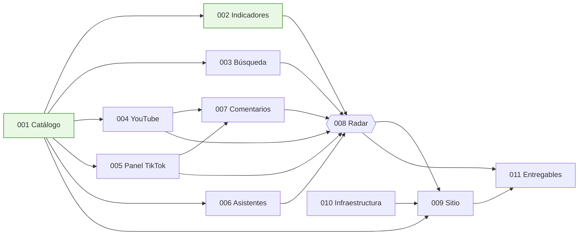

# Plan de ejecución

Orden de trabajo, dependencias y ruta crítica hacia la demostración. Las tareas viven en cada `specs/NNN-*/tasks.md`; este documento solo dice qué va primero y qué puede ir en paralelo.

## Dependencias entre specs

## Ruta crítica para la demostración

**001 → 006 → 008 → 009 → 010 (despliegue) → 011 (pitch)**

La auditoría de asistentes (006) es el insumo más diferenciador y el que más tarda en correr, porque son cientos de llamadas. Arranca en cuanto existan el corpus de prompts y las llaves.

## Carriles paralelos

Se pueden trabajar al mismo tiempo sin bloquearse, porque solo comparten el catálogo y los contratos:

| Carril | Specs | Entrega intermedia |
|---|---|---|
| Datos y análisis | 003, 006, 008 (luego 004 y 007) | `data/curado/` con los componentes de atención y el radar |
| Nube y sitio | 010, 009 | Sitio desplegado con mapa y fichas, primero con datos oficiales y después con el radar |
| Panel, negocio y entregables | 005, 011 | Panel convocado y cerrado, modelo de operación, documentos de entrega y pitch |

## Hitos

**D** es el día de la presentación final. El día exacto dentro del 15 al 17 de octubre se confirma con el comité.

| Hito | Contenido | Criterio de salida |
|---|---|---|
| H0 · Base | Repositorio, constitución, dominio, specs, catálogo y serie oficial | `make verificar` pasa. **Hecho** |
| H1 · Primeras señales | Corpus de prompts; primera tanda de asistentes en es y en; Trends de los 12 destinos; panel convocado; infraestructura aplicada | Tablas `asistentes_*` y `interes_busqueda_mensual` con datos; certificado emitido |
| H2 · Radar v1 | Radar con los componentes disponibles; sitio con mapa, radar y fichas usando datos reales; desplegado | URL pública funcionando; manifiesto 100 % verificado |
| H3 · Radar completo | Cinco idiomas en asistentes; panel cerrado; YouTube y comentarios (P1); modelo con rezago (P1) | Radar v2 exportado y desplegado |
| H4 · Entrega | Documentos de entrega generados; pitch ensayado; demostración sin conexión lista | Lista de verificación de la spec 011 completa |

Orden sugerido: H1 en la mañana de D-1, H2 en la tarde de D-1, H3 en la noche de D-1 y H4 en la mañana de D. Si el tiempo no alcanza, H3 se recorta a lo que esté listo; H2 y H4 no se recortan.

## Reglas de coordinación

1. **Tomar una tarea** = cambiar `[ ]` por `[~]` en su `tasks.md` y hacer commit (`chore: toma T006-03`). Al terminarla, `[x]` y commit con el resultado.
2. **Una tarea, un commit** cuando sea posible. El mensaje cita el identificador: `feat: corridas de asistentes en español (T006-05)`.
3. **Bloqueos:** si una tarea no puede avanzar, se anota en «Preguntas abiertas» de su spec y se toma otra del mismo carril.
4. **Cambios a contratos** (`contracts/`, `docs/dominio/modelo-de-datos.md`): se avisan en el commit con `contrato:` en el cuerpo, porque afectan a otro carril.
5. **Nada se publica** en el sitio sin pasar `make verificar`.

## Definición de terminado de la demostración

- [ ] Sitio en `techcapital.foor.dev` (o el subdominio acordado) con HTTPS.
- [ ] Los 12 Pueblos Mágicos en el radar, con al menos tres componentes de atención.
- [ ] Sección de asistentes con al menos 400 corridas, tres idiomas y dos proveedores, y fuentes citadas.
- [ ] Panel con al menos 15 participantes y protocolo publicado.
- [ ] Fichas descargables de los 12 destinos.
- [ ] «Cómo se hizo» con metodología, limitaciones y componentes con IA.
- [ ] Manifiesto 100 % verificado en el navegador.
- [ ] Documentos de la §9 de la convocatoria en `docs/entregables/`.
- [ ] Pitch ensayado dentro del tiempo y respaldo sin conexión probado.
