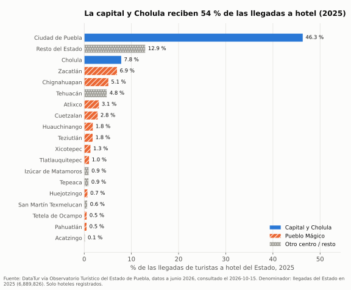
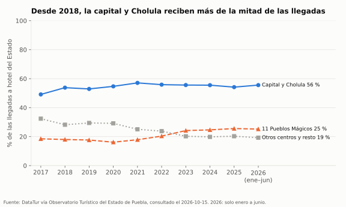
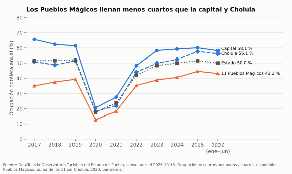
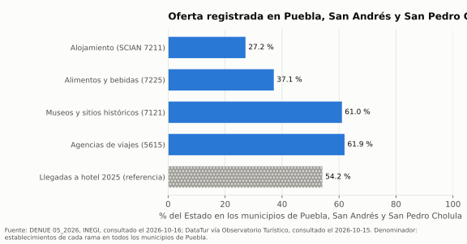
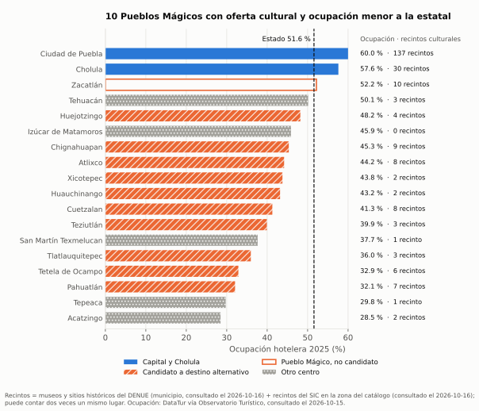
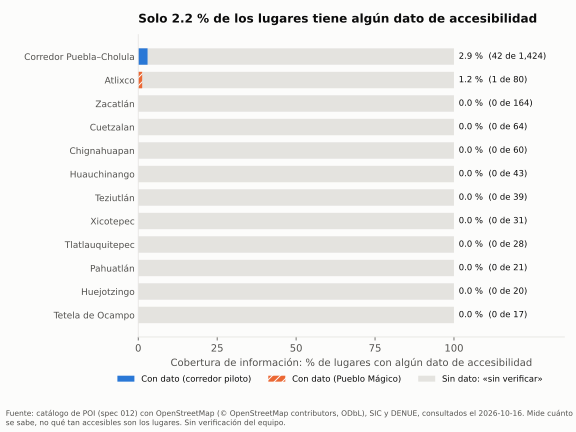

# Análisis del problema · Evidencia con datos

Generado por `analysis/01_problema.py` (spec 013) desde `data/curado/` y `data/referencia/`. No se edita a mano. Para regenerarlo:

```
uv run --project pipelines --extra analisis python analysis/01_problema.py
```

Año de referencia: 2025 (último año completo). 2026 solo tiene enero a junio y se muestra aparte. Las tablas están en `reports/013_*.csv` y las figuras en `reports/figuras/`.

## Cifras clave para el pitch

1. **54.2 %** de las llegadas de turistas a hotel del Estado en 2025 fueron a la capital y Cholula (3,731,575 de 6,889,826). Los 11 Pueblos Mágicos restantes recibieron 25.6 %. Fuente: DataTur vía Observatorio Turístico (`sectur-ot-2026-06`), consultado el 2026-10-15.
2. **60.0 %** de ocupación hotelera en la capital y **44.6 %** en el conjunto de los 11 Pueblos Mágicos sin Cholula (2025): 15.4 puntos de diferencia. Fuente: DataTur vía Observatorio Turístico (`sectur-ot-2026-06`), consultado el 2026-10-15.
3. **10 de 11** Pueblos Mágicos (sin Cholula) tienen oferta cultural registrada y ocupación por debajo del promedio estatal (51.6 %) en 2025: candidatos a destino alternativo. Entre todos tuvieron en promedio 2,750 cuartos libres por día. Fuentes: DataTur (`sectur-ot-2026-06`), DENUE (`inegi-denue`) y SIC (`sic-cultura`).
4. **61 %** de los museos y sitios históricos y **27 %** del alojamiento registrados en el DENUE del Estado están en los municipios de Puebla, San Andrés y San Pedro Cholula. Fuente: DENUE 05_2026, INEGI (`inegi-denue`), consultado el 2026-10-16.
5. **2.2 %** de los 1,991 lugares del catálogo tiene algún dato de accesibilidad en fuentes abiertas (43 lugares). En 10 de las 11 zonas de Pueblos Mágicos no hay ninguno. Es cobertura de información, no nivel de accesibilidad. Fuente: OpenStreetMap (`osm-overpass`), consultado el 2026-10-16.
6. **1 de 15** sanitarios públicos del catálogo dice si su baño es accesible. Fuente: OpenStreetMap (`osm-overpass`), consultado el 2026-10-16.

## A) Concentración de la demanda hotelera

**Hallazgos**

- En 2025, la capital recibió 46.3 % de las llegadas a hotel del Estado y Cholula 7.8 %. Juntas, 54.2 %.
- En 2017 esa proporción era 49.1 %. Entre 2018 y 2025 osciló entre 52.9 % y 57.1 %.
- Los 11 Pueblos Mágicos sin Cholula pasaron de 18.5 % (2017) a 25.6 % (2025) de las llegadas, y «Resto del Estado» bajó de 22.1 % a 12.9 %. Con estos datos no se puede separar cuánto es crecimiento real y cuánto cambio en los hoteles que mide cada centro.
- HHI de las llegadas entre los 16 centros con serie completa: 3,152 en 2025 (escala 0–10,000; con reparto igual sería 625). Mínimo 3,152 en 2025, máximo 4,072 en 2021. Gini 2025: 0.68.
- Ocupación 2025: capital 60.0 %, Cholula 57.6 %, Estado 51.6 %, 11 Pueblos Mágicos juntos 44.6 %. La más baja entre los Pueblos Mágicos: Pahuatlán (32.1 %).
- Los 11 Pueblos Mágicos sin Cholula tuvieron en promedio 3,438 cuartos libres por día en 2025.
- La estadía promedio va de 1.77 a 1.90 días en todos los centros: no distingue destinos.

| Centro | Grupo | Llegadas 2025 | % del Estado | Ocupación % | Estadía (días) |
|---|---|---|---|---|---|
| Ciudad de Puebla | Capital | 3,191,517 | 46.3 % | 60.0 | 1.86 |
| Resto del Estado | Resto del Estado | 890,453 | 12.9 % | — | — |
| Cholula | Cholula | 540,058 | 7.8 % | 57.6 | 1.86 |
| Zacatlán | Pueblo Mágico | 478,062 | 6.9 % | 52.2 | 1.80 |
| Chignahuapan | Pueblo Mágico | 351,514 | 5.1 % | 45.3 | 1.80 |
| Tehuacán | Otro centro | 328,281 | 4.8 % | 50.1 | 1.90 |
| Atlixco | Pueblo Mágico | 213,962 | 3.1 % | 44.2 | 1.79 |
| Cuetzalan | Pueblo Mágico | 196,014 | 2.8 % | 41.3 | 1.83 |
| Huauchinango | Pueblo Mágico | 124,634 | 1.8 % | 43.2 | 1.86 |
| Teziutlán | Pueblo Mágico | 122,242 | 1.8 % | 39.9 | 1.83 |
| Xicotepec | Pueblo Mágico | 90,541 | 1.3 % | 43.8 | 1.80 |
| Tlatlauquitepec | Pueblo Mágico | 69,393 | 1.0 % | 36.0 | 1.80 |
| Izúcar de Matamoros | Otro centro | 64,320 | 0.9 % | 45.9 | 1.77 |
| Tepeaca | Otro centro | 61,723 | 0.9 % | 29.8 | 1.78 |
| Huejotzingo | Pueblo Mágico | 46,536 | 0.7 % | 48.2 | 1.83 |
| San Martín Texmelucan | Otro centro | 42,587 | 0.6 % | 37.7 | 1.78 |
| Tetela de Ocampo | Pueblo Mágico | 34,787 | 0.5 % | 32.9 | 1.79 |
| Pahuatlán | Pueblo Mágico | 33,365 | 0.5 % | 32.1 | 1.81 |
| Acatzingo | Otro centro | 9,837 | 0.1 % | 28.5 | 1.79 |







- **Fuente:** Datos del Observatorio Turístico a junio 2026 (con glosario) (Secretaría de Desarrollo Turístico del Estado de Puebla), https://sectur.puebla.gob.mx/observatorioturistico/documentospdf/DatosOT%20a%20junio%202026%20glosario.pdf, consultado el 2026-10-15 (`sectur-ot-2026-06`). Llegadas, ocupación y estadía son datos medidos (DataTur).
- **Denominador:** llegadas de turistas a hotel del Estado por año (`centro_ot = Estado`, igual a la suma de los centros más «Resto del Estado»). El HHI y el Gini usan el panel fijo de 16 centros con serie 2017–2026; quedan fuera acatzingo, tepeaca (serie desde 2025) y «Resto del Estado».
- **Limitaciones:** solo cuenta huéspedes de hoteles registrados; no incluye excursionistas, que en Cholula y en los Pueblos Mágicos cercanos pueden ser muchos, ni hospedaje informal o por plataformas. 2020 refleja la pandemia. El HHI depende de cuántos centros mide DataTur.

## B) Concentración de la oferta

**Hallazgos**

- Alojamiento (SCIAN 7211): 1,436 establecimientos en 150 municipios; 27.2 % en Puebla, San Andrés y San Pedro Cholula; HHI entre municipios 695.
- Alimentos y bebidas (SCIAN 7225): 44,719 establecimientos en 215 municipios; 37.1 % en Puebla, San Andrés y San Pedro Cholula; HHI entre municipios 1,052.
- Museos y sitios históricos (SCIAN 7121): 118 establecimientos en 35 municipios; 61.0 % en Puebla, San Andrés y San Pedro Cholula; HHI entre municipios 2,483.
- Agencias de viajes (SCIAN 5615): 218 establecimientos en 27 municipios; 61.9 % en Puebla, San Andrés y San Pedro Cholula; HHI entre municipios 3,148.
- Para comparar: esos tres municipios reciben 54.2 % de las llegadas a hotel (2025).
- Recintos del SIC en las zonas del catálogo: 140; 95 en la capital y Cholula.

| Municipio | Alojamiento | Alimentos y bebidas | Museos y sitios | Agencias | % del Estado |
|---|---|---|---|---|---|
| Puebla | 323 | 13,661 | 57 | 119 | 30.5 % |
| Tehuacán | 88 | 2,684 | 3 | 18 | 6.0 % |
| San Andrés Cholula | 24 | 1,600 | 7 | 7 | 3.5 % |
| San Martín Texmelucan | 33 | 1,594 | 1 | 6 | 3.5 % |
| San Pedro Cholula | 43 | 1,333 | 8 | 9 | 3.0 % |
| Atlixco | 74 | 1,247 | 3 | 10 | 2.9 % |
| Izúcar de Matamoros | 30 | 899 | 0 | 3 | 2.0 % |
| Huauchinango | 40 | 858 | 1 | 1 | 1.9 % |
| Teziutlán | 26 | 834 | 0 | 1 | 1.9 % |
| Cuautlancingo | 6 | 825 | 0 | 0 | 1.8 % |



- **Fuentes:** Directorio Estadístico Nacional de Unidades Económicas; descarga masiva de Puebla (extracto SCIAN 7211; 7225; 7121; 5615) (INEGI), https://www.inegi.org.mx/contenidos/masiva/denue/denue_21_csv.zip, consultado el 2026-10-16 (`inegi-denue`); Sistema de Información Cultural: directorios de museos; zonas arqueológicas; centros culturales; teatros; galerías y casas de artesanías (Secretaría de Cultura), https://sic.cultura.gob.mx/datos.php, consultado el 2026-10-16 (`sic-cultura`).
- **Denominador:** establecimientos de cada rama en todos los municipios del Estado (DENUE); recintos del SIC dentro de las zonas del catálogo (corredor y círculos de 1.5 km de los Pueblos Mágicos).
- **Limitaciones:** el DENUE cuenta unidades económicas, no su tamaño ni su calidad; los establecimientos pequeños pueden estar desactualizados. Alimentos y bebidas incluye negocios de servicio local, no solo turístico. El SIC depende de que cada institución actualice su ficha y aquí solo se cuenta dentro de las zonas del catálogo.

## C) Desajuste oferta–demanda

**Criterio (explícito):** un destino es candidato a destino alternativo si cumple las dos:

1. Oferta cultural relevante: es Pueblo Mágico y tiene al menos un recinto cultural registrado (museo o sitio histórico del DENUE en su municipio, o recinto del SIC en su zona).
2. Baja demanda hotelera: ocupación 2025 menor que la del Estado (51.6 %).

Orden: primero los candidatos; dentro, por oferta cultural registrada (de más a menos) y luego por ocupación (de menos a más).

**Hallazgos**

- 10 candidatos: Chignahuapan, Cuetzalan, Atlixco, Pahuatlán, Tetela de Ocampo, Huejotzingo, Tlatlauquitepec, Teziutlán, Huauchinango, Xicotepec. Recibieron 18.6 % de las llegadas a hotel en 2025 y tuvieron 2,750 cuartos libres por día.
- 10 de 11 Pueblos Mágicos sin Cholula están por debajo de la ocupación estatal.
- Pueblos Mágicos que no son candidatos y por qué: Cholula (ocupación 57.6 % ≥ Estado); Zacatlán (ocupación 52.2 % ≥ Estado).

| # | Destino | Pueblo Mágico | Museos y sitios DENUE | Recintos SIC (zona) | Ocupación 2025 % | Dif. vs. Estado (pp) | Estadía (días) | Cuartos libres/día | Candidato |
|---|---|---|---|---|---|---|---|---|---|
| 1 | Chignahuapan | sí | 2 | 7 | 45.3 | -6.2 | 1.80 | 661 | sí |
| 2 | Cuetzalan | sí | 5 | 3 | 41.3 | -10.3 | 1.83 | 429 | sí |
| 3 | Atlixco | sí | 3 | 5 | 44.2 | -7.4 | 1.79 | 441 | sí |
| 4 | Pahuatlán | sí | 0 | 7 | 32.1 | -19.5 | 1.81 | 105 | sí |
| 5 | Tetela de Ocampo | sí | 1 | 5 | 32.9 | -18.7 | 1.79 | 108 | sí |
| 6 | Huejotzingo | sí | 1 | 3 | 48.2 | -3.4 | 1.83 | 96 | sí |
| 7 | Tlatlauquitepec | sí | 0 | 3 | 36.0 | -15.6 | 1.80 | 191 | sí |
| 8 | Teziutlán | sí | 0 | 3 | 39.9 | -11.6 | 1.83 | 284 | sí |
| 9 | Huauchinango | sí | 1 | 1 | 43.2 | -8.4 | 1.86 | 255 | sí |
| 10 | Xicotepec | sí | 0 | 2 | 43.8 | -7.8 | 1.80 | 179 | sí |
| 11 | Ciudad de Puebla | no | 57 | 80 | 60.0 | +8.4 | 1.86 | 4,253 | no |
| 12 | Cholula | sí | 15 | 15 | 57.6 | +6.0 | 1.86 | 630 | no |
| 13 | Zacatlán | sí | 4 | 6 | 52.2 | +0.6 | 1.80 | 688 | no |
| 14 | Tehuacán | no | 3 | 0 | 50.1 | -1.4 | 1.90 | 491 | no |
| 15 | Acatzingo | no | 2 | 0 | 28.5 | -23.1 | 1.79 | 41 | no |
| 16 | Tepeaca | no | 1 | 0 | 29.8 | -21.8 | 1.78 | 245 | no |
| 17 | San Martín Texmelucan | no | 1 | 0 | 37.7 | -13.9 | 1.78 | 108 | no |
| 18 | Izúcar de Matamoros | no | 0 | 0 | 45.9 | -5.7 | 1.77 | 117 | no |



- **Fuentes:** Datos del Observatorio Turístico a junio 2026 (con glosario) (Secretaría de Desarrollo Turístico del Estado de Puebla), https://sectur.puebla.gob.mx/observatorioturistico/documentospdf/DatosOT%20a%20junio%202026%20glosario.pdf, consultado el 2026-10-15 (`sectur-ot-2026-06`); Directorio Estadístico Nacional de Unidades Económicas; descarga masiva de Puebla (extracto SCIAN 7211; 7225; 7121; 5615) (INEGI), https://www.inegi.org.mx/contenidos/masiva/denue/denue_21_csv.zip, consultado el 2026-10-16 (`inegi-denue`); Sistema de Información Cultural: directorios de museos; zonas arqueológicas; centros culturales; teatros; galerías y casas de artesanías (Secretaría de Cultura), https://sic.cultura.gob.mx/datos.php, consultado el 2026-10-16 (`sic-cultura`).
- **Denominador:** los 18 destinos del catálogo (`data/referencia/destinos.csv`) con centro turístico en DataTur; ocupación 2025 de cada centro.
- **Limitaciones:** es un cruce descriptivo, no una relación causal: la baja ocupación puede deberse a acceso, distancia, temporada o tamaño de la planta hotelera. El conteo de recintos mezcla el municipio (DENUE) y la zona (SIC) y puede contar dos veces un lugar. Ser Pueblo Mágico se toma como señal de valor cultural reconocido; no mide atractivo natural. La ocupación de referencia incluye a la capital, que la eleva.

## D) Brecha de información de accesibilidad

Se reporta **cobertura de información**: cuántos lugares tienen algún dato de accesibilidad declarado en fuentes abiertas. No es el nivel de accesibilidad de los lugares. Un lugar sin dato queda «sin verificar».

**Hallazgos**

- 43 de 1,991 lugares del catálogo (2.2 %) tienen algún atributo de accesibilidad. Si se cuentan solo los lugares que vienen de OpenStreetMap (única fuente con estas etiquetas), son 43 de 1,376 (3.1 %).
- Corredor piloto Puebla–Cholula: 2.9 % (42 de 1,424). Zonas de Pueblos Mágicos: 1 de 567; 10 de 11 zonas sin ningún dato.
- Dato de acceso sin escalones: 41 lugares (sí: 29, parcial: 7, no: 5).
- Sanitarios públicos con dato de baño accesible: 1 de 15 (6.7 %).

| Zona | Lugares | Con algún dato | Cobertura de información | Sin dato («sin verificar») |
|---|---|---|---|---|
| Atlixco | 80 | 1 | 1.2 % | 79 |
| Chignahuapan | 60 | 0 | 0.0 % | 60 |
| Cuetzalan | 64 | 0 | 0.0 % | 64 |
| Huauchinango | 43 | 0 | 0.0 % | 43 |
| Huejotzingo | 20 | 0 | 0.0 % | 20 |
| Pahuatlán | 21 | 0 | 0.0 % | 21 |
| Corredor Puebla–Cholula | 1,424 | 42 | 2.9 % | 1,382 |
| Tetela de Ocampo | 17 | 0 | 0.0 % | 17 |
| Teziutlán | 39 | 0 | 0.0 % | 39 |
| Tlatlauquitepec | 28 | 0 | 0.0 % | 28 |
| Xicotepec | 31 | 0 | 0.0 % | 31 |
| Zacatlán | 164 | 0 | 0.0 % | 164 |
| Total del catálogo | 1,991 | 43 | 2.2 % | 1,948 |

| Categoría | Lugares | Con algún dato | Cobertura de información |
|---|---|---|---|
| alojamiento | 636 | 1 | 0.2 % |
| artesanias | 143 | 0 | 0.0 % |
| banio | 15 | 1 | 6.7 % |
| cafe | 145 | 11 | 7.6 % |
| centro_cultural | 82 | 0 | 0.0 % |
| mercado | 21 | 0 | 0.0 % |
| mirador | 1 | 0 | 0.0 % |
| museo | 101 | 1 | 1.0 % |
| otro | 36 | 0 | 0.0 % |
| parque | 122 | 1 | 0.8 % |
| restaurante | 545 | 28 | 5.1 % |
| sitio_historico | 30 | 0 | 0.0 % |
| templo | 107 | 0 | 0.0 % |
| zona_arqueologica | 7 | 0 | 0.0 % |



- **Fuentes:** OpenStreetMap: POI turísticos y etiquetas de accesibilidad (Overpass API) (OpenStreetMap contributors (ODbL 1.0)), https://overpass-api.de/, consultado el 2026-10-16 (`osm-overpass`) (etiquetas `wheelchair`, `toilets:wheelchair` y otras); catálogo integrado de la spec 012 (`data/curado/poi.csv` y `poi_accesibilidad.csv`).
- **Denominador:** todos los lugares del catálogo de la zona o categoría; se da también la cobertura sobre los lugares con registro de OpenStreetMap.
- **Limitaciones:** el SIC y el DENUE no publican accesibilidad, así que sus lugares sin enlace a OpenStreetMap no pueden tener dato. Las etiquetas de OpenStreetMap no están verificadas por el equipo. La ausencia de una etiqueta no prueba que el lugar sea o no accesible.

## E) Población residente con discapacidad motriz (pendiente)

Sin datos. El Censo de Población y Vivienda 2020 por AGEB y manzana (INEGI, PCDISC_MOT) no está descargado en el repositorio. No se estima ni se sustituye. Se hará cuando una spec de ingesta lo registre en `data/fuentes/fuentes.csv`; se usará solo como contexto agregado de población residente, con las celdas suprimidas por INEGI tratadas como suprimidas, no como cero.

## F) Pendiente del entorno peatonal (pendiente)

Sin datos. No hay un modelo digital de elevación (CEM de INEGI o Copernicus GLO-30) ni una red peatonal descargada. No se estima. Cuando exista, la resolución de 30 m no capta escalones ni banquetas y así se dirá.

## Lectura honesta

- Estos resultados describen concentración y brechas de información. No prueban por qué ocurren: las hipótesis H1–H3 del proyecto siguen siendo hipótesis.
- La serie hotelera solo ve a quien duerme en un hotel registrado. La afluencia de visitantes del Observatorio es un dato derivado (llegadas × factor fijo); por eso aquí se usan las llegadas, que son medidas.

Datos © OpenStreetMap contributors (ODbL 1.0). Directorios del Sistema de Información Cultural/Secretaría de Cultura. DENUE, INEGI. DataTur vía Observatorio Turístico del Estado de Puebla.
